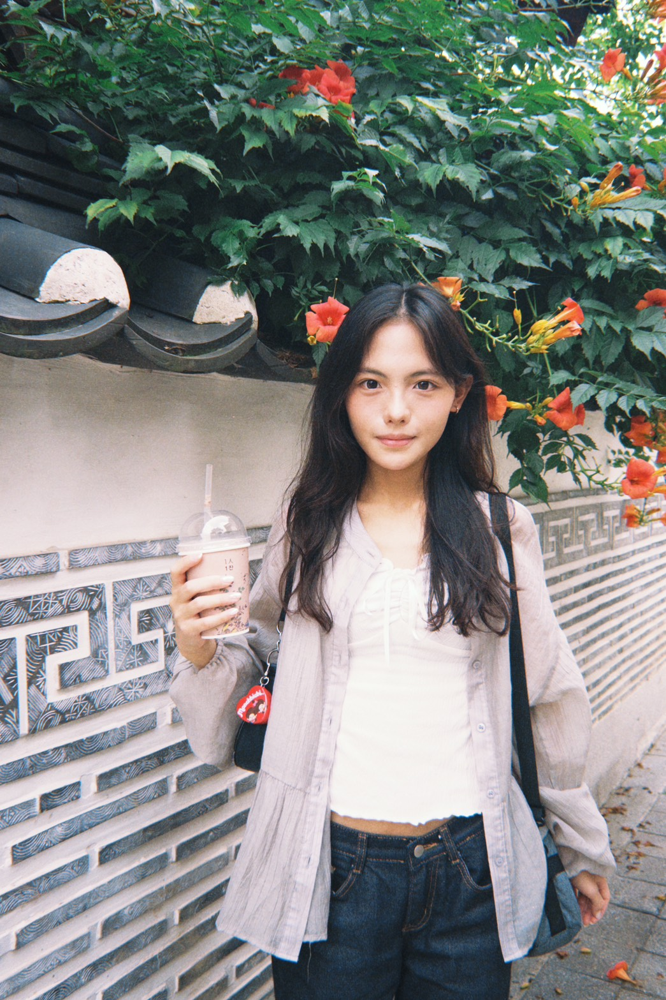
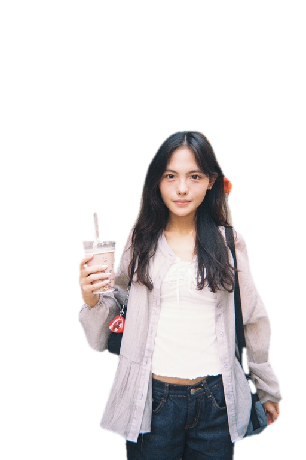
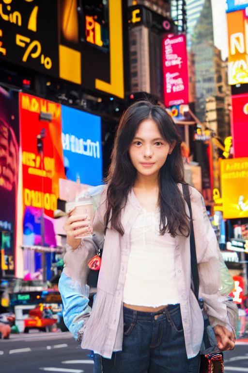
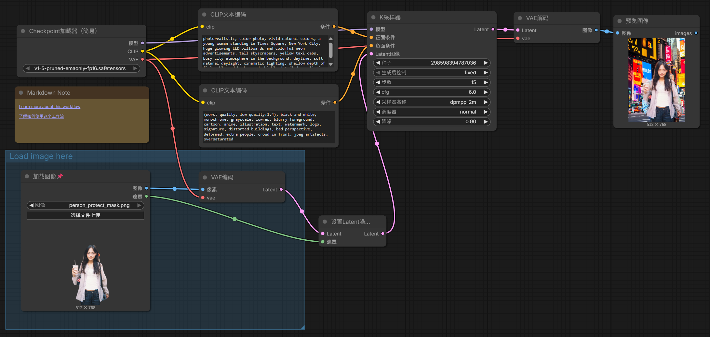

# ComfyUI 作業：人像背景替換（紐約時代廣場）

> **🌐 公開線上展示頁面 (GitHub Pages)**：  
> 👉 [https://qunxianlin.github.io/ComfyUI-/](https://qunxianlin.github.io/ComfyUI-/)

---

## 📌 作業內容說明

- **任務目標**：保留原圖中的人物特徵，利用遮罩（Mask）技術，僅替換背景為紐約時代廣場街景。
- **解決方案**：
  - 最初直接生成時，人物面部特徵容易產生畸變或改變。
  - 後續採用遮罩只鎖定背景區域進行重繪，完整保留原圖人物面部及細節。
- **關鍵參數**：Denoise（降噪幅度）設為 `0.9`。

---

## 🖼️ 效果對比

| 原圖 (Original) | 遮罩 (Mask) | 生成結果 (Result) |
| :---: | :---: | :---: |
|  |  |  |

---

## ⚙️ 提示詞設定 (Prompts)

### 正面提示詞 (Positive Prompt)
```text
photorealistic, color photo, vivid natural colors, a young woman standing in Times Square, New York City, huge glowing LED billboards and colorful neon advertisements, tall skyscrapers, yellow taxi cabs, busy city atmosphere in the background, daytime, soft natural daylight, cinematic lighting, shallow depth of field, blurred background, highly detailed, realistic
```

### 負面提示詞 (Negative Prompt)
```text
(worst quality, low quality:1.4), black and white, monochrome, grayscale, lowres, blurry foreground, cartoon, anime, illustration, text, watermark, logo, signature, distorted buildings, bad perspective, deformed, extra people, crowd in front, jpeg artifacts, oversaturated
```

---

## 🧩 完整 ComfyUI 工作流

- **工作流截圖**：
  

- **工作流檔案**：
  [`我的工作流.json`](我的工作流.json)
